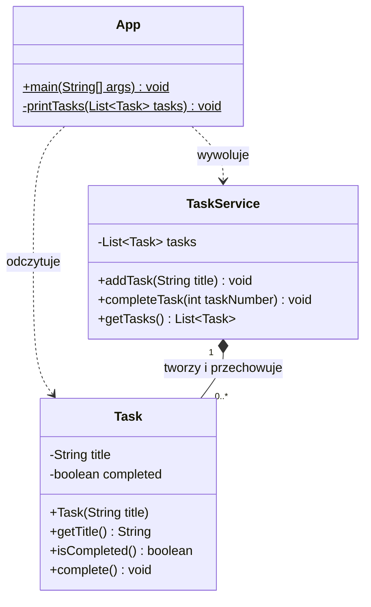

# Diagram klas

App obsługuje konsolę, TaskService zarządza listą, Task przechowuje dane jednego zadania.
Strzałka przerywana oznacza użycie klasy. Romb oznacza kompozycję:
TaskService tworzy i przechowuje zadania. 0..* oznacza dowolną liczbę zadań.
Znak + oznacza element publiczny, - prywatny, a $ metodę statyczną.
